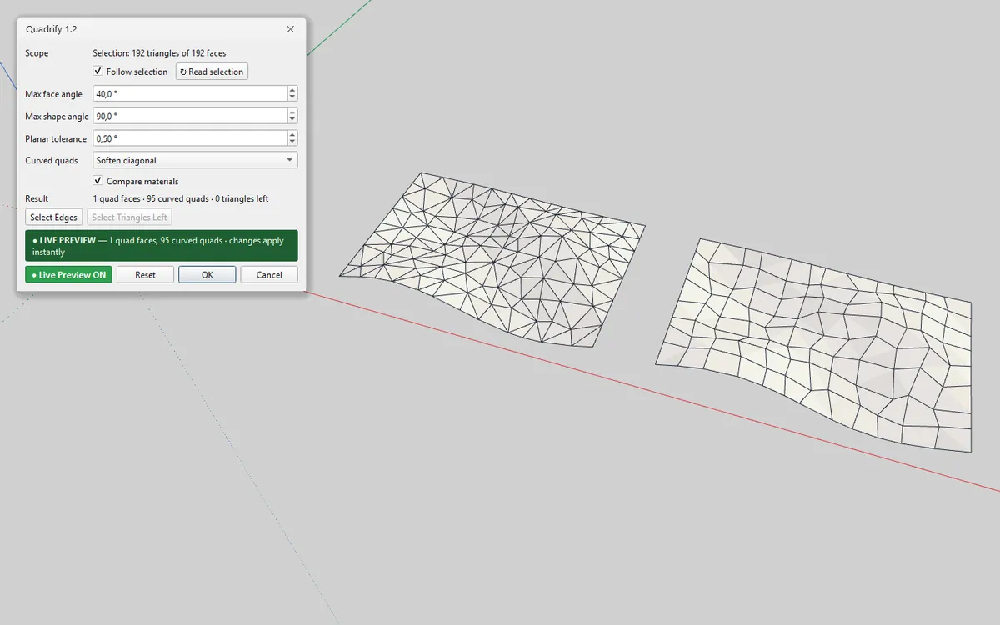

# Quadrify — triangles to quads for IngeTrazo

Turns triangulated meshes (OBJ, STL, DAE, glTF, terrain) into **four-sided faces**, and rebuilds terrain as a clean **grid of quads**.

[Deutsch → LIESMICH.md](LIESMICH.md)

## Installation
1. In IngeTrazo: **Extensions ▸ Open plugins folder** (Windows: `%APPDATA%\ingetrazo\plugins\`, Linux: `~/.local/share/ingetrazo/plugins/`).
2. Copy `quadrify_tool.py` into that folder.
3. Restart IngeTrazo → **Extensions ▸ Quadrify ▸** *Quadrify… · Grid Remesh…* (also on the right-click menu when faces are selected).

Requires IngeTrazo ≥ 0.5.6 (extension API 2) · tested with IngeTrazo 0.6.0.

## Quadrify…
Removes the diagonal between two triangles wherever they make a good quad. Works on the selected faces, or on the whole mesh being edited when nothing is selected (open a group first to work inside it).

- **Flat pairs** become one real quad face; paint and tags go with it.
- **Curved pairs** (sphere, terrain) cannot be one face in IngeTrazo — faces are planar — so the diagonal is **softened** (or hidden) and the pair reads as a quad. *Keep triangles* leaves them alone.
- **Max face angle** — how much two triangles may fold against each other. **Max shape angle** — how far each corner may stray from 90° (raise it up to 90° for irregular meshes such as terrain). **Planar tolerance** — up to this fold a pair becomes one real face. **Compare materials** — only pair triangles with the same paint.
- The pairing finds the largest possible number of quads; **Select Triangles Left** shows what remains, **Select Edges** the diagonals that would go.
- **Live Preview** (as in every PESI3D plugin): the quads stand in the model at once, as one undo step, and follow every change; **OK** keeps them, **Cancel** takes them back, **Reset** = default settings. Preview off, the plan is drawn over the model: green = becomes a quad face, orange = softened diagonal.
- **Follow selection** / **↻ Read selection**: select other faces while the dialog is open and the preview moves there.

## Grid Remesh…
Rebuilds faces as a regular grid. **Surface**: *Height field* lays the grid seen from above (terrain); *Any shape* makes **quads only**, like a retopology: the surface is cut into patches at its hard edges and every patch gets a structured quad grid ending exactly on its outline — four corners: a grid (opposite sides get the same number of quads); round: an O-grid (inner square and rings); a tube between two outlines (a duct, a loft from a rectangle to a circle): rings from one outline to the other. Neighbouring patches share their edge points, so the result is closed. Patches with holes or more than four corners fall back to the cut grid; *Auto* takes the height field where the faces are one, else any shape. Inside each patch: quads everywhere inside, border cells cut to the outline (*Clip to outline*) or left out (*Whole cells only*). Heights are sampled from the old surface. **Spacing**, **Grid angle** (*Auto* turns the grid along the site), **Planar tolerance**; Live Preview, Follow selection, Reset, OK, Cancel as in Quadrify….

Both commands are one undo step; the dialogs do not block the viewport (orbit, pan, zoom).

## Units
The dialog works in the **units of the open document** — set in IngeTrazo under **Window ▸ Units…** (Ctrl+U) or **Window ▸ Preferences… ▸ Units**:
- Length fields show and take the document's length unit and form: m, cm, mm, in, ft, feet-and-inches (`9'10"`) or fractional feet-and-inches (`9'10 1/8"`).
- Type with or without a unit: `25`, `2,5 cm`, `1'2"`, `3/4"`. A number without a unit is in the document's unit (inches in a feet-and-inches document); a value typed in another unit is converted.
- Angles are in the document's angle unit (degrees, radians or gon), areas in its area unit; per-cent fields and counts have no unit. The decimal separator follows the document — `.` and `,` are both accepted when typing.
- Changing the units only changes how values are shown and typed — the model stays exactly as it is. Open the dialog again after changing them.
- On IngeTrazo builds before 0.5.8 the fields are plain numbers in metres.
- **Grid Remesh…**: **Spacing** is a length in the document's unit; a very small spacing on a big model warns before the long computation (the dialog opens first).
- **Max face angle**, **Max shape angle**, **Grid angle** and **Planar tolerance** are angles in the document's angle unit.

## Changelog
- **1.3** — **Grid Remesh on any shape**: new **Surface** setting — *Height field* (terrain, seen from above), *Any shape* (**quads only**, like a retopology: patches at hard edges, each a structured quad grid — grid, O-grid or rings — joined without gaps; ducts, lofts from a rectangle to a circle, walls, boxes) or *Auto*. **Document units** in every field (spacing, angles). Tested with IngeTrazo 0.6.0.
- **1.2** — the PESI3D Live Preview in both dialogs: the real result in the model as one undo step (button *● Live Preview ON*, banner, *Reset*, *OK* keeps the preview, *Cancel* takes it back). Tested with IngeTrazo 0.5.8.
- **1.1** — own toolbar **Quadrify** with one icon per command (Quadrify… · Grid Remesh…). It starts on a row of its own under the built-in toolbars; move, float or hide it like those (right-click on a toolbar). Icons drawn in IngeTrazo's own style, they follow the light/dark theme.
- **1.0** — first release.

## Licence
GPL-3.0-or-later · © 2026 Pesi (pesi3d.de) · [Impressum](https://pesi3d.de)

3ds Max is a trademark of Autodesk, Inc.; it is named only to describe the function («Quadrify All / Quadrify Selection»). This plugin is not affiliated with or endorsed by Autodesk.
